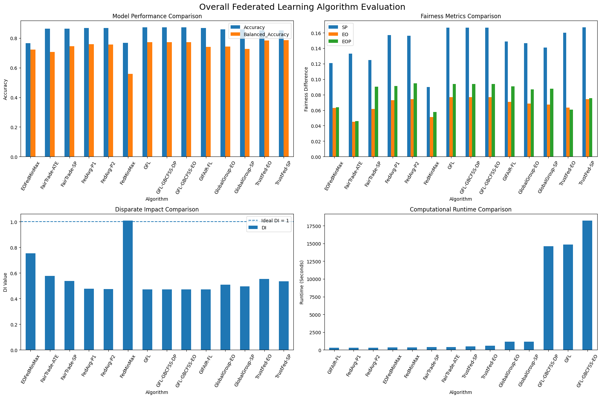
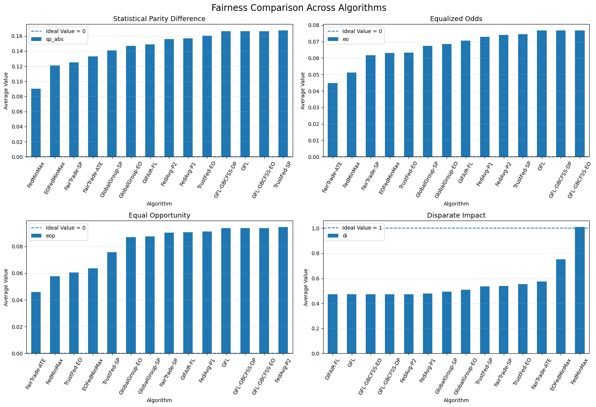
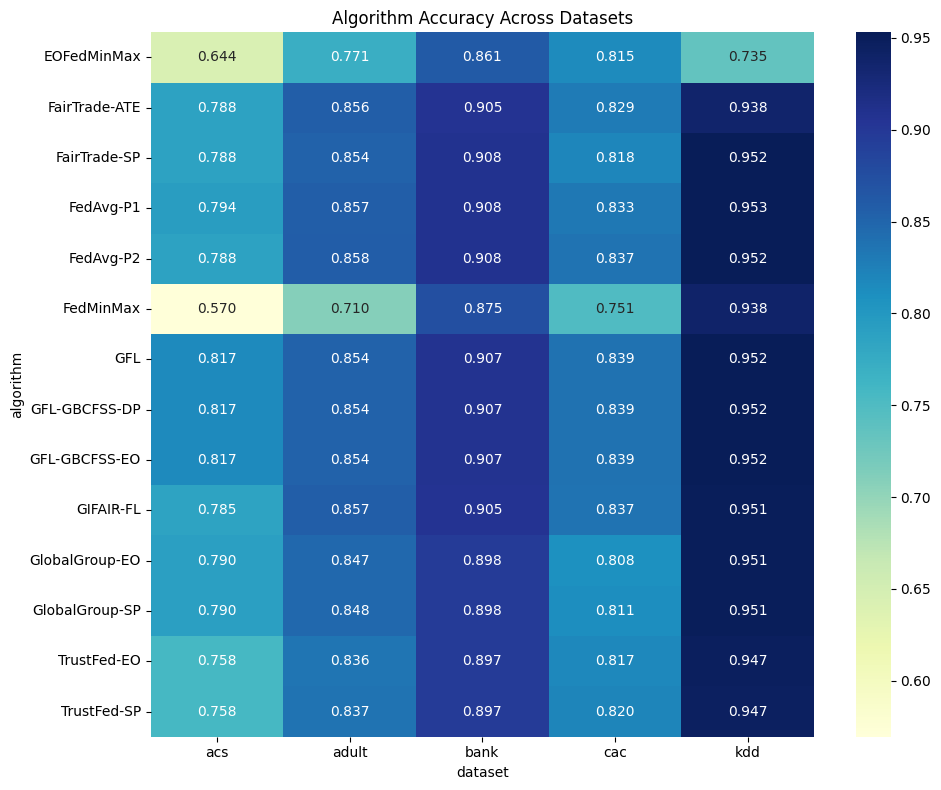
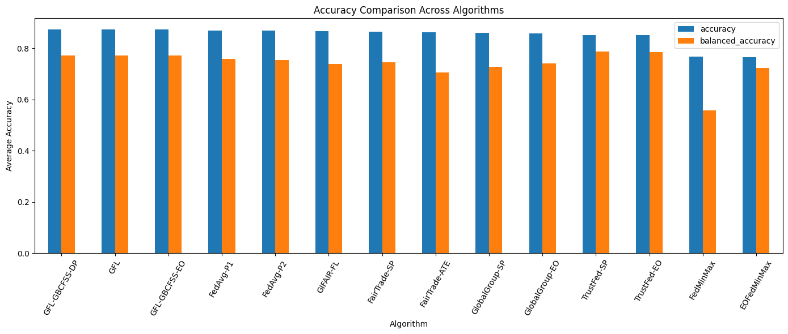
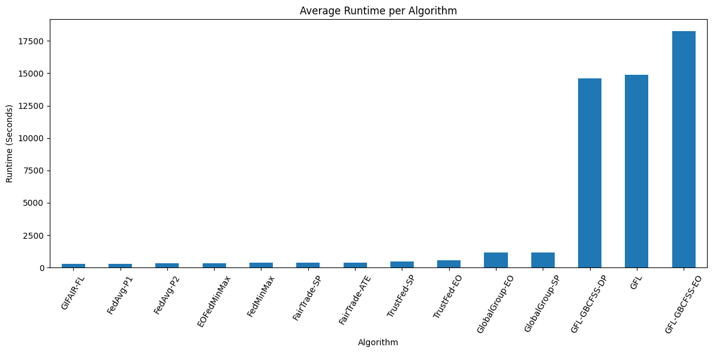
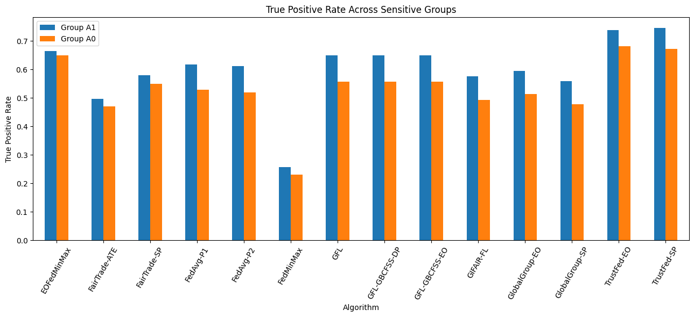
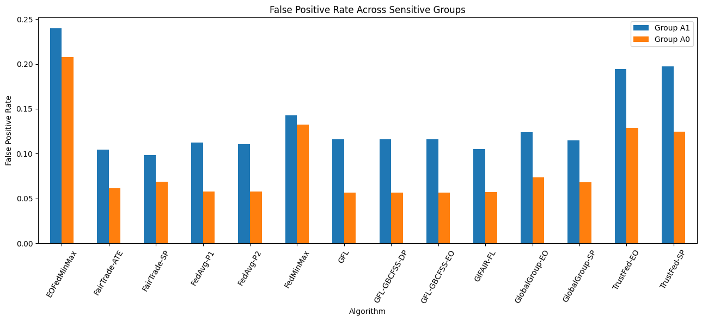
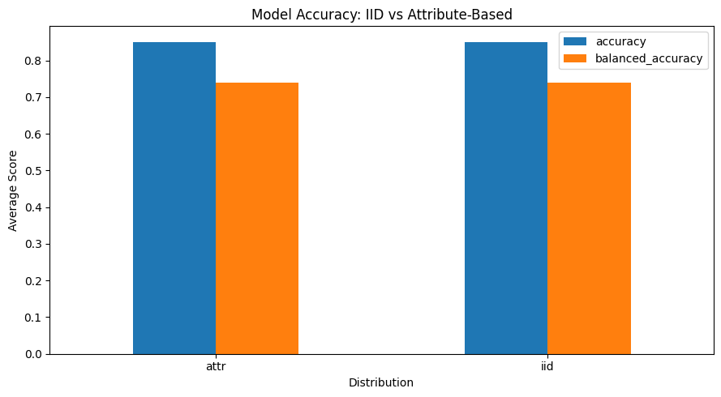
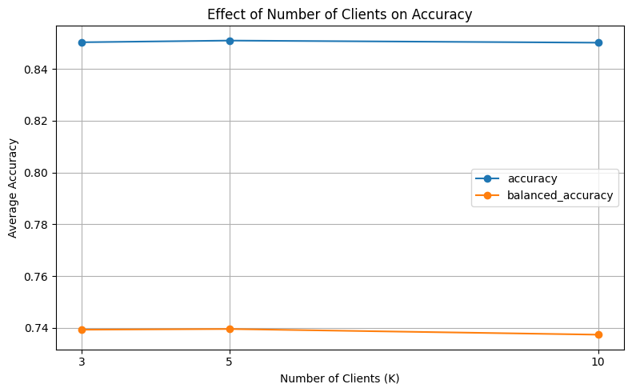
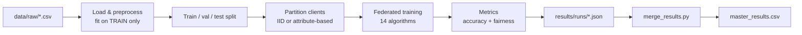

<div align="center">

# ⚖️ Fair-FL Unified Benchmark

**14 Fair Federated Learning algorithms · 5 datasets · one shared protocol · 1,750 experiments**

[](environment.yml)
[](LICENSE)
[](tests/)
[](results/summary/master_results.csv)
[](https://colab.research.google.com/drive/19dEIPiXVaPy3LRnDN9qxln9bcFiSzSr3?usp=sharing)



</div>

---

## 📖 Overview

A from-scratch, single-codebase benchmark that re-implements **14 Fair Federated Learning
algorithm variants** drawn from two independent university course projects, runs them all under
**one shared client / split / metric protocol**, and reports them side by side on **5 datasets**.

- 🧱 **Independent re-implementation.** No code imports from either original project. Every
  algorithm and data-handling rule was re-derived from the source and validated against it before
  any large-scale run.
- 📏 **Like-for-like comparison.** Same splits, same client partitions, same metrics and same seeds
  for every algorithm.
- 🔁 **Reproducible on a laptop.** Plain Python CLI with resumable sweeps, no cluster or scheduler
  needed.
- 📝 **Documented choices.** [`DEVIATIONS.md`](DEVIATIONS.md) is the evidence-backed log of every
  place the behaviour had to be pinned down. Read it before interpreting the results.

## ✅ Status

**Complete: 1,750 / 1,750 cells filled.** That's 5 datasets × 14 algorithms × 5 client settings ×
5 seeds, with no missing cells. The full table is
[`results/summary/master_results.csv`](results/summary/master_results.csv).

| Dimension | Values |
|---|---|
| **Datasets** | Adult · Bank Marketing · Communities & Crime (CaC) · Census-Income KDD · ACS |
| **Client settings** | `iid10` · `iid5` · `iid3` · `attr5` · `attr3` (IID or attribute-based, K clients) |
| **Seeds** | 0 · 1 · 2 · 3 · 4 |
| **Metrics** | Accuracy · Balanced accuracy · SP · EO · EOP · DI · per-group TPR / FPR · runtime |

---

## 📊 Results

> Charts come from the analysis notebook
> [](https://colab.research.google.com/drive/19dEIPiXVaPy3LRnDN9qxln9bcFiSzSr3?usp=sharing).
> Every number is a mean over all 125 runs per algorithm (5 datasets × 5 settings × 5 seeds).
> These are pooled averages across very different datasets; use them as an overview, and check
> the per-dataset breakdown before drawing conclusions about one dataset.

### Summary table

| Algorithm | Accuracy ↑ | Bal. Acc ↑ | SP ↓ | EO ↓ | EOP ↓ | DI (→ 1) | Runtime ↓ |
|---|---:|---:|---:|---:|---:|---:|---:|
| GFL | **0.874** | 0.773 | 0.166 | 0.077 | 0.094 | 0.473 | 4.1 h |
| GFL-GBCFSS-DP | **0.874** | 0.773 | 0.166 | 0.077 | 0.094 | 0.473 | 4.1 h |
| GFL-GBCFSS-EO | **0.874** | 0.773 | 0.166 | 0.077 | 0.094 | 0.473 | 5.1 h |
| FedAvg-P1 | 0.869 | 0.758 | 0.157 | 0.073 | 0.091 | 0.477 | 5.1 min |
| FedAvg-P2 | 0.869 | 0.755 | 0.156 | 0.074 | 0.095 | 0.474 | 5.2 min |
| GIFAIR-FL | 0.867 | 0.740 | 0.149 | 0.071 | 0.091 | 0.472 | **4.6 min** |
| FairTrade-SP | 0.864 | 0.746 | 0.125 | 0.062 | 0.090 | 0.538 | 6.2 min |
| FairTrade-ATE | 0.863 | 0.706 | 0.133 | **0.045** | **0.046** | 0.576 | 6.5 min |
| GlobalGroup-SP | 0.860 | 0.728 | 0.141 | 0.067 | 0.088 | 0.494 | 19.5 min |
| GlobalGroup-EO | 0.859 | 0.742 | 0.147 | 0.069 | 0.087 | 0.508 | 19.3 min |
| TrustFed-SP | 0.852 | **0.787** | 0.167 | 0.074 | 0.076 | 0.535 | 7.9 min |
| TrustFed-EO | 0.851 | 0.784 | 0.160 | 0.063 | 0.061 | 0.553 | 9.6 min |
| FedMinMax | 0.769 | 0.558 | **0.090** | 0.051 | 0.058 | **1.010** | 6.0 min |
| EOFedMinMax | 0.765 | 0.723 | 0.121 | 0.063 | 0.064 | 0.752 | 5.8 min |

<sub>SP = |statistical parity difference|, EO = equalized odds, EOP = equal opportunity,
DI = disparate impact (ideal = 1; `NaN` runs skipped). Runtime is mean wall-clock per run on the
cluster nodes used for the sweep. **Bold** = best in column.</sub>

### 💡 Key takeaways

1. **No single algorithm wins on every fairness metric.** FedMinMax is best on SP and DI;
   FairTrade-ATE is best on EO and EOP.
2. **High accuracy does not mean fair.** The GFL family has the highest accuracy (~0.87) but
   some of the largest fairness gaps.
3. **FedMinMax trades accuracy for fairness.** It has the lowest SP and the DI closest to 1, but
   also the lowest balanced accuracy (0.56).
4. **FairTrade-ATE is a good balance.** It keeps accuracy at 0.86 while having the smallest EO
   and EOP gaps.
5. **Cost varies by ~60×.** The GFL family averages 4–5 h per run, while most other methods
   finish in under 10 min.

### Fairness across algorithms

<p align="center">
  
</p>

### Accuracy across datasets

<p align="center">
  
</p>

ACS is the hardest dataset for every method, and FedMinMax / EOFedMinMax lose the most accuracy
there (0.57 / 0.64).

<details>
<summary><b>📈 More charts</b> (accuracy, runtime, per-group rates, data distribution, number of clients)</summary>

<br>

**Accuracy vs. balanced accuracy**
<p align="center"></p>

**Runtime per algorithm**
<p align="center"></p>

**True positive rate per sensitive group**
<p align="center"></p>

**False positive rate per sensitive group**
<p align="center"></p>

**IID vs. attribute-based partitioning** and **number of clients K**: averaged over all
algorithms, neither changes accuracy much (≈ 0.85 accuracy, ≈ 0.74 balanced accuracy in every case).

<p align="center">
  
  
</p>

</details>

---

## 🧪 Algorithms

| Source | Algorithms in this benchmark |
|---|---|
| **Paper 1** (Arnous, Schrader, Olschewski) | `FedAvg-P1` · `FedMinMax` · `EOFedMinMax` · `GlobalGroup-SP` · `GlobalGroup-EO` · `TrustFed-SP` · `TrustFed-EO` |
| **Paper 2** (Thern, Rehn) | `FedAvg-P2` · `GIFAIR-FL` · `FairTrade-SP` · `FairTrade-ATE`\* · `GFL` · `GFL-GBCFSS-EO` · `GFL-GBCFSS-DP` |

<sub>\* `FairTrade-ATE` is an extra variant added by this benchmark and is not in the original project.</sub>

The two original repositories are classmates' own coursework and are not included here. They are
cited only as the provenance of each algorithm; [`DEVIATIONS.md`](DEVIATIONS.md) names the exact
file and function each implementation was derived from.

## 🗂️ Datasets

Adult, Bank Marketing, Communities & Crime ("CaC"), Census-Income KDD, and ACS (American Community
Survey, per-US-state files). All are standard public fairness-ML datasets. They are **not included**
in this repo (see [Setup](#%EF%B8%8F-setup)); put your own copies under `data/raw/`.

## 🏗️ How it works



## 📁 Layout

```
fl/                    the unified codebase
  config.py              shared protocol constants (seeds, client fraction, splits, ...)
  data/                  loaders, preprocessing, train/val/test split (fit on TRAIN only)
  partition/             IID and attribute-based client partitioning
  metrics.py             fairness/accuracy metrics (undefined -> NaN, never 0)
  models.py              shared model architectures
  federated/             one module per algorithm: client/server training loop
  algorithms/            thin per-algorithm adapters used by the runner
  experiment.py          one experiment = dataset x setting x algorithm x seed, resumable
  merge.py               flattens every results/runs/*.json into one summary table
scripts/
  run_benchmark.py       main CLI: run one combo, time one combo, or sweep many (resumable)
  merge_results.py       builds results/summary/master_results.csv from results/runs/
tests/                 pytest suite (metrics, partitioning, no-leakage, merge, per-phase)
results/
  runs/                  one JSON per experiment (gitignored: regenerate by re-running)
  summary/master_results.csv   the full 1,750-row flattened table (tracked)
docs/figures/          charts used in this README (from the Colab analysis notebook)
environment.yml        conda/micromamba environment spec
DEVIATIONS.md          every deviation from the original code / harmonisation choice, with evidence
```

<details>
<summary><b>What's not here</b></summary>

<br>

A full history of this project exists but is deliberately left out of this repo, since none of it
is needed to set up and reproduce the experiment on a laptop. That history includes phase-by-phase
write-ups, the oracle-equivalence validation harness and its evidence, the two original repos, the
course PDFs, and the SLURM scripts used to run the full sweep on a university cluster. If you want
any of that, you'll need to recreate it yourself. For example, you could write your own
SLURM/cluster submission script around `scripts/run_benchmark.py`; the CLI has no cluster
dependency and runs as a plain Python process.

</details>

---

## ⚙️ Setup

```bash
conda env create -f environment.yml   # or: micromamba create -f environment.yml
conda activate fair-fl-benchmark      # or: micromamba activate fair-fl-benchmark
```

Requires **Python 3.10**. The datasets are not included (several hundred MB). Place your own copies
under `data/raw/` before running anything:

```
data/raw/
  adult.csv
  bank.csv
  communities.csv
  kdd.csv
  acs/<state>_data.csv     # one file per US state
```

## 🚀 Usage

### Run the tests

```bash
python3 -m pytest tests/ -v
```

### Reproduce a single result

```bash
python3 scripts/run_benchmark.py run \
  --dataset adult --algo FedAvg-P1 --dist iid --k 3 --seed 0
```

`run_benchmark.py run --help` lists every option. `--dataset` and `--algo` accept any of the 5
datasets and 14 algorithms, `--dist` is `iid` or `attr`, and `--k` is the client count.

### Reproduce the full benchmark (or any slice of it)

```bash
python3 scripts/run_benchmark.py sweep \
  --datasets adult,bank,cac,kdd,acs \
  --algos FedAvg-P1,FedMinMax,EOFedMinMax,GlobalGroup-SP,GlobalGroup-EO,TrustFed-SP,TrustFed-EO,FedAvg-P2,GIFAIR-FL,FairTrade-SP,FairTrade-ATE,GFL,GFL-GBCFSS-EO,GFL-GBCFSS-DP \
  --settings iid10,iid5,iid3,attr5,attr3 \
  --seeds 0,1,2,3,4 \
  --workers 4
```

- Every flag defaults to "all", so a bare `sweep` reproduces the entire 1,750-cell grid.
- ⏳ The full grid took on the order of **weeks** of wall-clock time on a 12-core cluster node for
  the largest dataset, so expect it to take a while on a laptop. Use
  `--datasets` / `--algos` / `--settings` to run a smaller slice, and set `--workers` to your CPU
  core count.
- 🔁 The sweep is **resumable**. Each combination is one JSON file under `results/runs/`, and a
  combination already marked `"status": "Completed"` is never recomputed, so you can safely stop
  and restart it.
- Add `--dry-run` to preview the combination list without running anything, or `--limit N` to
  cap it for a quick smoke test.

### Rebuild the summary table

```bash
python3 scripts/merge_results.py
```

This flattens every file in `results/runs/` into `results/summary/master_results.csv`.

> [!NOTE]
> Three of the 60 columns can legitimately be missing in some rows ([`DEVIATIONS.md`](DEVIATIONS.md)
> has the full breakdown):
> - `loss` and `C` are null for specific algorithms whose own config dict never recorded that
>   field. This is a documented code-level fact, not incomplete logging; the real value still
>   exists in that algorithm's training code.
> - `di` (Disparate Impact) is `NaN`, never `0`, whenever its denominator is mathematically
>   undefined for that run.
>
> Aggregate these columns with pandas' default `.mean()`, which skips `NaN`. Never apply
> `.fillna(0)` to them.

---

## 📐 Principles

Do not deviate from these without recording it in [`DEVIATIONS.md`](DEVIATIONS.md).

- No code here imports from either original project's repository. Every algorithm and every
  data-handling rule is independently re-implemented from reading that source.
- The sensitive attribute is removed from the model input `X` by the data loaders themselves.
- Every data-dependent quantity (medians, encoders, scalers, orientation) is fit on the **TRAIN**
  split only. The test set is never used for any kind of selection.
- Metrics return `NaN`, never `0`, for undefined quantities.

## 📄 License

MIT; see [`LICENSE`](LICENSE). This covers this project's own code only. The datasets keep their
original licenses and terms, and the two original student repositories cited above are not
included.
